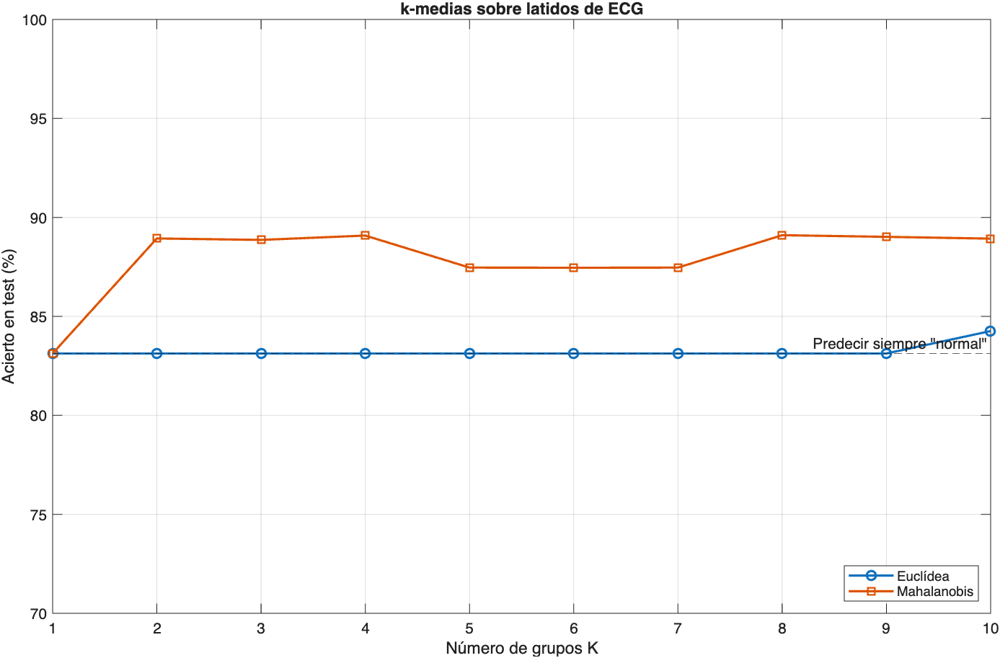

# k-medias para clasificar arritmias cardiacas

Clasificación de latidos de electrocardiograma en 5 clases (normal y 4 tipos de
arritmia) con **k-medias implementado a mano**, comparando la distancia
**euclídea** con la de **Mahalanobis**.

## Cómo funciona

1. Se agrupan los latidos de entrenamiento en *K* grupos con k-medias
   ([`funciones/kmedias.m`](../funciones/kmedias.m)): asignar cada latido al centroide
   más cercano y mover cada centroide a la media de su grupo, hasta que nada cambie.
   Con Mahalanobis, cada grupo tiene además su propia matriz de covarianza.
2. Cada centroide se etiqueta con la clase más frecuente entre sus latidos.
3. Cada latido de test recibe la etiqueta del centroide más cercano.

Para reducir el tiempo de cálculo se usa el 50 % de los latidos (43.777 de
entrenamiento y 10.946 de test) y las 93 primeras muestras de cada uno.

## Resultados

| | Mejor acierto en test | K |
|---|---|---|
| Predecir siempre "normal" | 83,1 % | — |
| k-medias, distancia euclídea | 84,3 % | 10 |
| k-medias, distancia de Mahalanobis | **89,1 %** | 8 |

**Por qué la euclídea no mejora:** el 82,5 % de los latidos son normales y las
arritmias se solapan con ellos. Con distancia euclídea los grupos son esféricos,
casi todos acaban dominados por la clase normal y el clasificador predice
"normal" para casi todo; su acierto coincide con el de esa estrategia trivial.

**Por qué Mahalanobis sí:** cada grupo aprende su covarianza y puede adoptar
formas elípticas. A partir de K = 2 unos grupos cubren la nube de latidos
normales y otros se especializan en las arritmias, y el acierto sube unos 6
puntos por encima de la referencia.

Los resultados varían ligeramente entre ejecuciones si se cambia la semilla
(`rng`), porque cambian el subconjunto de latidos y los centroides iniciales.

## Cómo ejecutarlo

1. Descargar `mitbih_train.csv` y `mitbih_test.csv` del
   [ECG Heartbeat Categorization Dataset](https://www.kaggle.com/datasets/shayanfazeli/heartbeat)
   (derivado de la base MIT-BIH Arrhythmia de PhysioNet) y dejarlos en esta carpeta.
   No se incluyen en el repositorio porque ocupan más de 500 MB.
2. Ejecutar `kmedias_ecg.m` en MATLAB. Tarda alrededor de un minuto.
