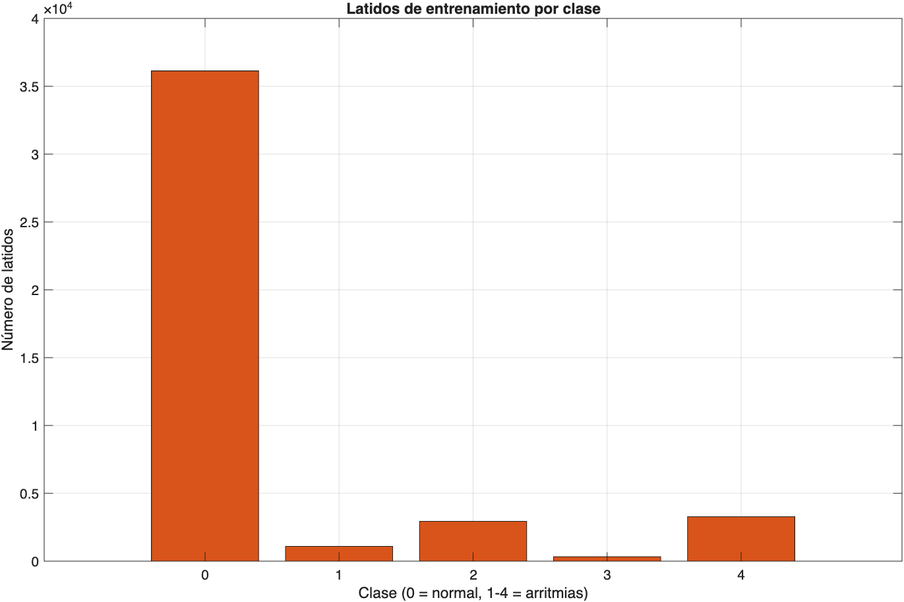

# k-means for cardiac arrhythmia classification

Classification of electrocardiogram heartbeats into 5 classes (normal and 4
types of arrhythmia) with **k-means implemented from scratch**, comparing the
**Euclidean** and **Mahalanobis** distances.

## How it works

1. The training heartbeats are grouped into *K* clusters with k-means
   ([`funciones/kmedias.m`](../funciones/kmedias.m)): each heartbeat is assigned
   to its nearest centroid and each centroid is moved to the mean of its
   cluster, until nothing changes. With Mahalanobis, each cluster also has its
   own covariance matrix.
2. Each centroid is labelled with the most frequent class among its heartbeats.
3. Each test heartbeat gets the label of its nearest centroid.

To reduce computation time, 50 % of the heartbeats are used (43,777 for training
and 10,946 for test), with the first 93 samples of each one.

## Results

| | Best test accuracy | K |
|---|---|---|
| Always predicting "normal" | 83.1 % | — |
| k-means, Euclidean distance | 84.3 % | 10 |
| k-means, Mahalanobis distance | **89.1 %** | 8 |

**Why Euclidean does not improve:** 82.5 % of the heartbeats are normal and the
arrhythmias overlap with them. With the Euclidean distance the clusters are
spherical, almost all of them end up dominated by the normal class, and the
classifier predicts "normal" for almost everything: its accuracy matches that
trivial strategy.

**Why Mahalanobis does:** each cluster learns its own covariance and can take
elliptical shapes. From K = 2 on, some clusters cover the cloud of normal
heartbeats while others specialise in the arrhythmias, and accuracy rises about
6 points above the baseline.

Results vary slightly between runs if the seed (`rng`) is changed, because both
the subset of heartbeats and the initial centroids change.

## How to run

1. Download `mitbih_train.csv` and `mitbih_test.csv` from the
   [ECG Heartbeat Categorization Dataset](https://www.kaggle.com/datasets/shayanfazeli/heartbeat)
   (derived from the PhysioNet MIT-BIH Arrhythmia database) and place them in
   this folder. They are not included in the repository because they take more
   than 500 MB.
2. Run `kmedias_ecg.m` in MATLAB. It takes about a minute.
