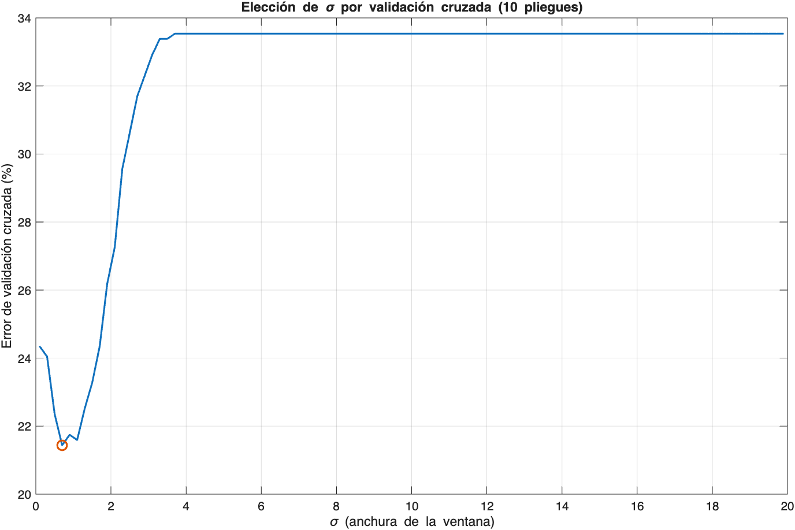
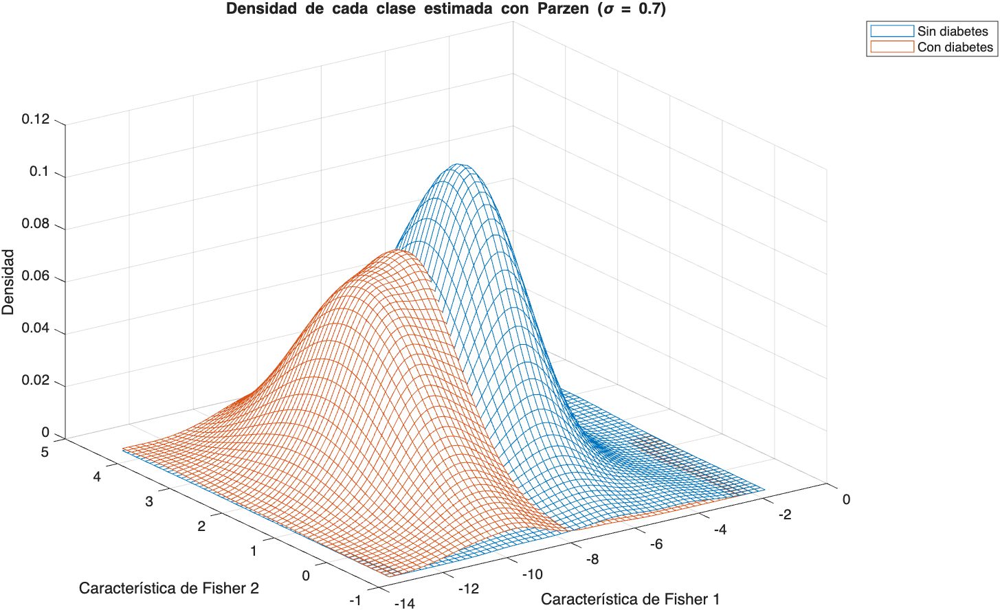

# Ventanas de Parzen: diagnóstico de diabetes

Clasificador bayesiano no paramétrico para el conjunto de datos *Pima Indians
Diabetes* (768 pacientes, 8 variables clínicas; 500 sin diabetes y 268 con diabetes).

## Cómo funciona

1. **Separación de datos:** se reserva un 15 % de pacientes solo para test. Todo
   lo demás (Fisher y la elección de σ) se ajusta con el 85 % restante.
2. **Reducción a 2 características** con el discriminante lineal de Fisher
   ([`funciones/fisher_lda.m`](../funciones/fisher_lda.m)).
3. **Estimación de densidad** de cada clase con ventanas de Parzen
   ([`funciones/densidad_parzen.m`](../funciones/densidad_parzen.m)): la densidad en
   un punto es la media de gaussianas de anchura σ centradas en cada paciente.
4. **Clasificación bayesiana:** cada paciente va a la clase con mayor
   P(clase) · p(x | clase).
5. **Elección de σ** por validación cruzada de 10 pliegues, probando valores de
   0,1 a 20.

## Resultados

| | Error |
|---|---|
| Validación cruzada (σ = 0,7) | 21,4 % |
| **Test (115 pacientes no vistos)** | **25,2 %** |

Como referencia, en el benchmark StatLog los mejores métodos sobre estos datos
rondan el 22–25 % de error.

Con σ pequeño la densidad es un conjunto de picos sobre cada paciente y se
sobreajusta; con σ grande se suaviza tanto que a partir de σ ≈ 4 el clasificador
acaba eligiendo siempre la clase mayoritaria (sin diabetes) y el error se estanca en torno al 33,5 %.

Las dos densidades se solapan bastante: con solo 2 características las clases no
se separan del todo. Además, con 2 clases Fisher solo tiene una dirección útil
(un único autovalor no nulo), así que la segunda característica apenas aporta.

## Cómo ejecutarlo

Ejecutar `parzen_diabetes.m` en MATLAB. Los datos están incluidos en
`datos/diabetes.mat` (del benchmark StatLog). Tarda unos segundos.
